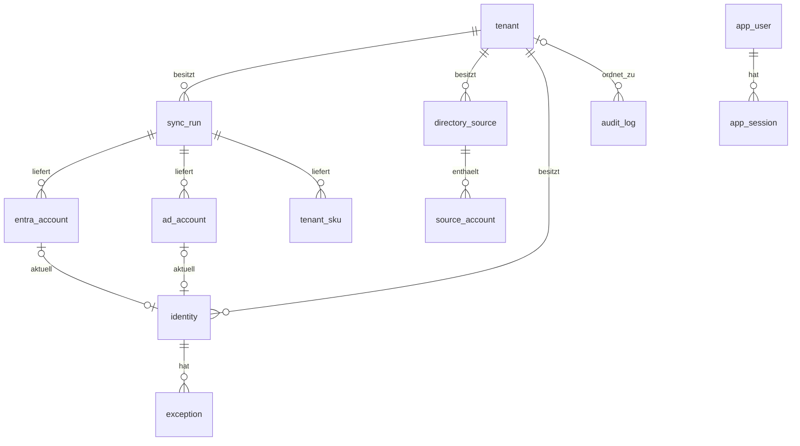

# Datenmodell und Aufbewahrung

Die Anwendung verwendet SQLAlchemy und Alembic mit SQLite. Zeitwerte werden als UTC gespeichert und
müssen timezone-aware sein. Kundendaten tragen `tenant_id` direkt oder gehören über eine
Fremdschlüsselbeziehung zu einem Mandanten. `sku_name`, `app_user` und `app_session` sind global.
Jede Abfrage auf Kundendaten filtert zusätzlich nach dem Mandanten.

## Tabellen

### `tenant`

Lokale Projektion der `tenants.yaml`, identifiziert durch das eindeutige `slug`. Enthält Anzeigename,
Aktivstatus, Entra-/AD-Verbindungsparameter, Secret-Namen, Schwellenwerte, Kontoartmuster und
Berichtsempfänger. Secret-Werte stehen nie in dieser Tabelle. Bei jedem Start werden vorhandene
Einträge aktualisiert, neue angelegt und aus der YAML entfernte deaktiviert; sie werden nicht
gelöscht.

### `sync_run`

Ein Abruf pro Mandant und Quelle (`entra` oder `ad`) mit Start/Ende, Status, Kontenzahl, festem
Fehlercode, Warncodes und AD-DC-Gesundheitsdaten. Unterbrochene `running`-Läufe werden beim nächsten
Start als fehlgeschlagen abgeschlossen. Läufe bleiben als technisches Protokoll erhalten, auch wenn
ihre Rohkonten bereinigt werden.

### `directory_source`

Dauerhafter Namensraum eines Entra- oder AD-Verzeichnisses innerhalb eines Mandanten. Die externe
Referenz ist je Mandant und Quellenart eindeutig und wird kanonisch kleingeschrieben ohne
Rand-Leerzeichen gespeichert. Die Tabelle ist mit Migration `0010` als Grundlage für Phase 6.1
vorhanden. Ein erfolgreicher Entra-Abruf erfasst dessen konfigurierte Verzeichnis-ID; alte Läufe
werden nicht rückwirkend zugeordnet. Insbesondere
wird aus einem AD-DNS-Namen noch kein bestätigter, unveränderlicher Verzeichnisanker abgeleitet.

### `source_account`

Dauerhafte Referenz eines externen Kontos innerhalb eines `directory_source`. Die externe Objekt-ID
ist je Mandant und Verzeichnis eindeutig. Ein zusammengesetzter Fremdschlüssel einschließlich
`tenant_id` verhindert Verweise auf ein Verzeichnis eines anderen Mandanten. Die Referenz ist von
einzelnen Rohdatenläufen unabhängig und bleibt bei deren Bereinigung bestehen. Erfolgreiche und
teilweise Entra-Abrufe erfassen gültige Objekt-IDs wiederholbar; ungültige IDs werden ausgelassen.
Bei ungültiger Verzeichnis- oder Konto-ID erhält der Lauf den Status `partial` und die Warnung
`entra_source_references_incomplete`; die übrigen abgerufenen Kontodaten bleiben verfügbar.
AD-Abrufintegration, Backfill und Verknüpfung mit `identity` folgen in weiteren Paketen von Phase 6.1.

### `entra_account`

Rohzustand eines Entra-Kontos innerhalb eines Laufs: Objekt-ID, UPN, Anzeigename, Mail, Kontostatus,
Erstellung, Sync-/Immutable-ID, bewertete Anmeldezeiten und Lizenzzuweisungen. Eindeutig je
`(sync_run_id, object_id)`. Alte Zeilen werden nach der Aufbewahrungsregel gelöscht, außer sie
gehören zum jüngsten brauchbaren Lauf der Quelle.

### `ad_account`

Rohzustand eines AD-Kontos innerhalb eines Laufs: objectGUID, sAMAccountName, UPN, Mail,
userAccountControl, Erstellungs-/Passwort-/Anmelde-/Ablaufwerte, `lastLogon` je DC, OU,
Gruppenmitgliedschaften und Kennzeichen unvollständiger Stammdaten. Eindeutig je
`(sync_run_id, object_guid)`; gleiche Aufbewahrung wie Entra-Rohdaten.

### `tenant_sku`

Lizenzbestand aus `subscribedSkus` je Entra-Lauf mit SKU-ID/Teilenummer, Geltungsbereich, Status,
verfügbaren und verbrauchten Einheiten. Eindeutig je `(sync_run_id, sku_id)` und gemeinsam mit alten
Rohläufen bereinigt.

### `identity`

Zusammengeführtes, über Läufe stabiles Konto pro Mandant. Der eindeutige `(tenant_id, key)` bleibt
für Ausnahmen und Entscheidungen erhalten. Die Zeile verweist auf die aktuell verwendeten Entra-/AD-
Rohkonten und speichert Ergebnisfelder: Anzeigename, letzte Anmeldung, automatische/manuelle
Kontoart, Status, Markierung, Empfehlung sowie Zustand der Verschwundenen-Prüfung.

Verweise auf bereinigte Rohkonten werden `NULL` (`ON DELETE SET NULL`). Verschwindet ein Konto aus
den Quellen, bleibt die Identität bis zu einer bewussten Entscheidung bestehen. Lokales Löschen in
der Prüfliste entfernt über Cascade auch ihre Ausnahmen.

### `exception`

Befristete fachliche Ausnahme einer Identität mit Grund, Ersteller und Gültigkeitsende. Sie gehört
immer zu demselben Mandanten wie die Identität. Gründe sind sensible Kundendaten: Sie erscheinen in
der Oberfläche und Sicherung, aber nie im Audit-Detail oder technischen Log.

### `sku_name`

Globale Zuordnung der Microsoft-Teilenummer zu Anzeigename und `is_free`. Beim Start gewinnt die
optionale lokale Korrekturdatei über den mitgelieferten Katalog. Unbekannte SKUs verwenden ihre
Teilenummer als Anzeige.

### `audit_log`

Unveränderliches Anwendungsprotokoll mit optionalem Mandanten, UTC-Zeit, Akteur, Aktionscode und
bereinigtem technischen Detail. Es enthält IDs, Zahlen und feste Codes, keine Namen, Mailadressen,
Suchtexte, Ausnahmegründe, Tokens oder externe Fehlermeldungen. Vollständiger Ereigniskatalog:
[audit-log.md](audit-log.md).

### `app_user`

Globale Tool-Benutzer der Softchem-IT. Lokale Konten speichern eindeutigen Normalnamen,
Argon2id-Hash, Passwortwechsel-/Aktiv-/Admin-/Sperrstatus und Zeitwerte. Entra-Konten werden eindeutig
über `(oidc_tenant_id, oidc_object_id)` zugeordnet und tragen keinen nutzbaren lokalen Passwort-Hash.
Tool-Benutzer werden deaktiviert statt gelöscht, damit Audit-Akteure nachvollziehbar bleiben.

### `app_session`

Serverseitige Sitzung eines Tool-Benutzers mit SHA-256-Hash des zufälligen Cookietokens,
unabhängigem CSRF-Token, Erstellungs-/Ablaufzeit und Kennzeichen `is_oidc`. Access-/Refresh-Tokens
werden hier nie gespeichert. Passwortwechsel, Reset, Deaktivierung und Logout löschen Sitzungen;
ein Datenbank-Restore löscht sämtliche alten Sitzungen.

## Lösch- und Aufbewahrungsregeln

| Daten | Regel |
|---|---|
| Rohkonten und `tenant_sku` | älter als `KW_RETENTION_DAYS` löschen; jüngsten brauchbaren Lauf je Mandant/Quelle behalten |
| `directory_source`, `source_account` | dauerhaft; neue Entra-Abrufe erfassen Referenzen, kein Backfill oder Bereinigungsablauf |
| `sync_run` | dauerhaftes technisches Laufprotokoll |
| `identity` | laufend aktualisieren; verschwundene bis zur Prüflistenentscheidung behalten |
| `exception` | auch abgelaufen sichtbar, bis manuell entfernt oder Identität lokal gelöscht wird |
| `audit_log` | keine automatische Bereinigung implementiert |
| `app_user` | deaktivieren statt löschen |
| `app_session` | bei Ablauf beim Laden entfernt; zusätzlich bei sicherheitsrelevanten Benutzeraktionen |

SQLite-Fremdschlüssel sind aktiv. Mandantenlöschung ist kein normaler Anwendungsablauf;
`ON DELETE CASCADE` schützt dennoch die referenzielle Integrität der mandantenbezogenen Tabellen.

## Migrationen und Sicherungen

Migrationen liegen fortlaufend unter `app/db/migrations/versions/`; aktueller Stand ist `0010`.
Modell und Migrations-Head werden per Test verglichen. Vor einer ausstehenden Migration versucht der
Start eine lokale Sicherung. Das ersetzt nicht die manuelle, geprüfte Sicherung vor einem Update.
Verfahren zum Erstellen einer Migration: [Architektur](architecture.md#migrationen-schreiben),
Restore: [Betriebsanleitung](operations.md#update-und-rückfall).
